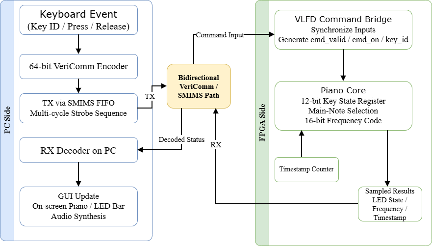
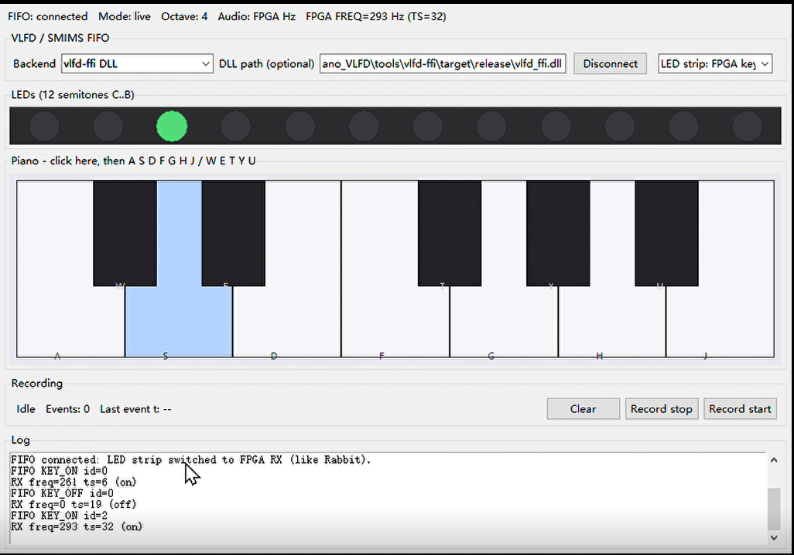

# FPGA VeriComm Piano

> A closed-loop host-FPGA electronic piano built with Verilog RTL, a 64-bit VeriComm/SMIMS FIFO link, and a Python GUI/audio host.

[](rtl/fpga_piano_top_vlfd.v)
[](host/pc_keyboard)
[](constraints/piano_vlfd_cons.xml)

This course project implements the complete path from a PC keyboard event to synchronized FPGA state and back to the host. The PC encodes key events into 64-bit VeriComm words and sends a multi-cycle FIFO transaction. The FPGA synchronizes the command, updates a 12-key state register and frequency lookup table, then returns the LED state, active frequency, and event timestamp for GUI display and audio synthesis.



## What this project demonstrates

- **Clock-domain-safe command capture:** a two-stage synchronizer samples `key_id`, `key_on`, and the command strobe before the command enters the piano core.
- **One command per strobe:** `fired_while_high` compresses a level-held strobe into a single-cycle `cmd_valid` pulse, avoiding duplicate key events.
- **Stateful digital design:** a 12-bit key register tracks simultaneous notes; when the active note is released, priority logic selects the highest remaining key.
- **Hardware-derived feedback:** the FPGA exposes the key LEDs, a 16-bit frequency code, and a 16-bit event timestamp. The host decodes these returned fields instead of treating the GUI as the source of truth.
- **Protocol-aware host software:** the Python stack handles 64-bit packing, 4 × 16-bit conversion, multi-cycle FIFO sequencing, background I/O, GUI updates, and audio generation.
- **Replaceable transports:** the same manager supports a local mock backend and an optional native `vlfd-ffi` hardware backend.
- **Verification and implementation evidence:** the repository includes a Verilog testbench, constraints, selected synthesis/placement artifacts, a generated bitstream, waveform output, the course report, and an end-to-end demonstration.

## End-to-end data path

```text
PC key press/release
        │
        ▼
64-bit VeriComm encoder
        │
        ▼
SMIMS FIFO: stable data → strobe high → strobe low
        │
        ▼
2-FF command synchronizer + one-shot capture
        │
        ▼
12-key state / main-note selection / frequency LUT / timestamp
        │
        ▼
LED state + frequency + timestamp sampled over the RX path
        │
        ▼
Python decoder → GUI LEDs and piano → audio playback
```

## Implementation map

| Area | Implementation | Key idea |
| --- | --- | --- |
| FPGA top and piano core | [`rtl/fpga_piano_top_vlfd.v`](rtl/fpga_piano_top_vlfd.v) | Synchronization, one-shot command capture, note state, LUT, timestamp |
| HDL simulation | [`sim/tb_fpga_piano_top_vlfd.v`](sim/tb_fpga_piano_top_vlfd.v) | Exercises A/S/D press-release transactions at a 100 MHz model clock |
| VeriComm codec | [`host/pc_keyboard/codec.py`](host/pc_keyboard/codec.py) | Pin-aware 64-bit TX packing and RX field decoding |
| FIFO transaction | [`host/pc_keyboard/fifo_sequence.py`](host/pc_keyboard/fifo_sequence.py) | Stable-low, pulse-high, return-low command sequence |
| Transport abstraction | [`host/pc_keyboard/transport`](host/pc_keyboard/transport) | Mock transport and optional `ctypes` native runtime adapter |
| Background control | [`host/pc_keyboard/vlfd_manager.py`](host/pc_keyboard/vlfd_manager.py) | Worker queue, FIFO pumping, decoded feedback callback |
| GUI and audio | [`host/pc_keyboard/ui_vlfd.py`](host/pc_keyboard/ui_vlfd.py) | Keyboard interaction, LED/piano rendering, FPGA-frequency audio |
| FPGA constraints | [`constraints/piano_vlfd_cons.xml`](constraints/piano_vlfd_cons.xml) | Board I/O and VeriComm pin assignments |
| Build evidence | [`artifacts/`](artifacts) | Bitstream, mapping reports, placement report, waveform |

## Hardware feedback demo

The screenshot below shows a live hardware connection with key ID 2 active. The FPGA reports `293 Hz` and timestamp `32`; the returned LED field selects the matching on-screen key.



- [Watch the end-to-end PC keyboard / FPGA demo](assets/fpga-piano-demo.mp4)
- [Read the complete course report](docs/course-report.pdf)

## Run the host application

### 1. Install dependencies

Python 3.9+ is recommended. Tkinter is included with the standard Windows Python distribution.

```bash
python -m venv .venv
.venv\Scripts\activate
python -m pip install -r requirements.txt
```

### 2. Start without FPGA hardware

```bash
python -m host.pc_keyboard
```

Select **mock (no USB)** in the backend menu. This mode exercises the GUI, keyboard bindings, transaction generation, and host-side application flow without a board.

### 3. Connect the FPGA backend

The native hardware runtime is intentionally not bundled. Build [`vlfd-ffi`](https://github.com/0xtaruhi/vlfd-ffi), then either select the resulting library in the GUI or set:

```powershell
$env:VLFD_FFI_DLL = 'C:\path\to\vlfd_ffi.dll'
python -m host.pc_keyboard
```

The host adapter expects `vlfd_io_open`, `vlfd_io_write_read`, `vlfd_io_close`, and `vlfd_get_last_error_message` from that runtime.

## Simulate the RTL

With Icarus Verilog installed:

```bash
iverilog -g2012 -o fpga_piano_tb.vvp rtl/fpga_piano_top_vlfd.v sim/tb_fpga_piano_top_vlfd.v
vvp fpga_piano_tb.vvp
```

The testbench applies press/release transactions for C, D, and E and prints the returned LED and frequency state. Define `DUMP_VCD` to generate a fresh waveform.

## Repository layout

```text
rtl/                     Synthesizable Verilog design
sim/                     Verilog testbench
host/pc_keyboard/        VeriComm/FIFO application and GUI
host/electronic_keyboard Shared UI, note, recorder, and audio modules
constraints/             FPGA pin constraints
artifacts/               Selected implementation and simulation evidence
assets/                  Architecture, screenshots, and demo video
docs/                    Full course report
extras/lab1-lcd/         Supplemental Lab 1 LCD RTL exercise
tests/                   Host protocol and packaging regression tests
```

## Supplemental Lab 1

[`extras/lab1-lcd/rtl/display.v`](extras/lab1-lcd/rtl/display.v) preserves the earlier course exercise: an FPGA LCD name-display controller. It is included as supporting RTL work; the VeriComm piano is the primary project in this repository.

## Notes on scope

This is a curated portfolio version of the course project. Tool installations, virtual environments, build caches, unrelated reference projects, and local logs are excluded. The original report and selected generated artifacts are retained so the design can be evaluated alongside its implementation evidence.
